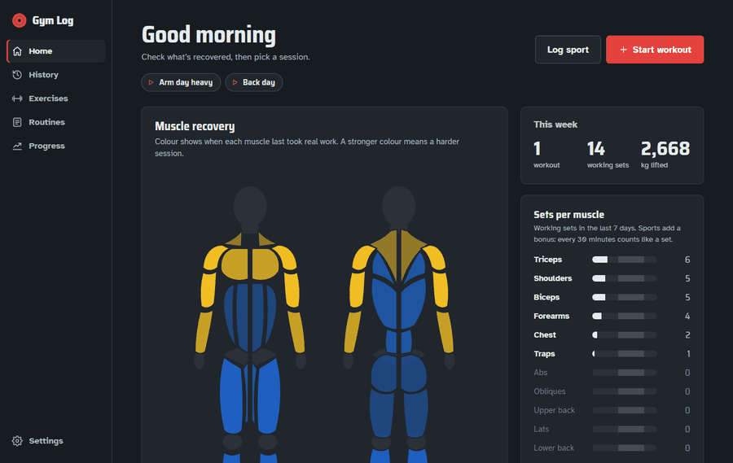

# Gym Log

<p align="center"></p>

Local gym tracker with a muscle-recovery heat map, a fast workout logger, progress charts and an offline iPhone app that syncs with it.

📱 **[Install it on your iPhone](docs/iphone-install.md)** — step-by-step guide, about 10 minutes.

## Run

```
npm install
npm run seed   # loads data/exercises.json + images/ + videos/ into db/gym.sqlite
npm start      # http://localhost:3000
```

`npm start` seeds automatically if the database is empty. Needs Node 22.13+ (uses the built-in `node:sqlite`).

To use the full app from your phone's browser on the same Wi-Fi, start it with `HOST=0.0.0.0 npm start` (PowerShell: `$env:HOST='0.0.0.0'; npm.cmd start`) and open `http://<your-PC-IP>:3000`. For the offline app at the gym, see the iPhone app below.

## Pages

- **Home** — start a freestyle workout (opens straight into the exercise picker) or one from a routine, this week at a glance, recent workouts.
- **History** — every finished workout with sets, volume and duration; edit, delete or save as a routine.
- **Exercises** — search and filter the library, see GIF + instructions + your records; add your own.
- **Routines** — build reusable workouts with target sets/reps/rest. Four starter routines are included.
- **Logger** — tick off sets as you go; last session's numbers pre-filled, per-exercise kg/lb, plate calculator, rest timer. Autosaves.
- **Progress** — estimated 1RM, top set and volume per exercise, rep maxes, weekly volume.
- **Settings** — display unit, bar weight, theme, database backup.

## iPhone app

The same server also serves an offline home-screen app at `/m`: log workouts and sports at the gym with no connection, see the recovery map, muscle heads, sets per muscle and history from the last sync, and tap **Sync** on home Wi-Fi to send everything to the PC.

Setting it up, in short:

1. On the PC: `node scripts/make-cert.js` once, then start with `HOST=0.0.0.0` (the desktop shortcut does this).
2. On the iPhone, in Safari: download `http://<PC-IP>:3000/m/ca.crt`, install it in Settings, and turn it on under **General › About › Certificate Trust Settings**.
3. Open `https://<PC-IP>:3443/m/` and choose Share › **Add to Home Screen** (with **Open as Web App** on).

**[Full guide with troubleshooting →](docs/iphone-install.md)**

## Data

- `data/exercises.json` — 1,324 exercises (schema in `data/exercises.schema.json`).
- `images/` and `videos/` — thumbnails and GIFs. They are **not** in git; the seed copies them into the database as BLOBs.
- `db/gym.sqlite` — everything: exercises, media, routines, workouts, sets, settings. Back it up from the Settings page.

## Units

Each set is stored in the unit it was logged in (kg or lb). Charts, PRs and volume convert to the display unit chosen in Settings.

## Test

```
npm test
```

## License

[MIT](LICENSE). The exercise data, images and animations come from their own sources and keep their own terms.
